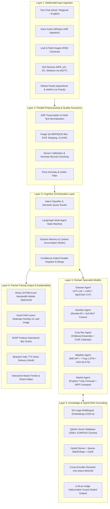
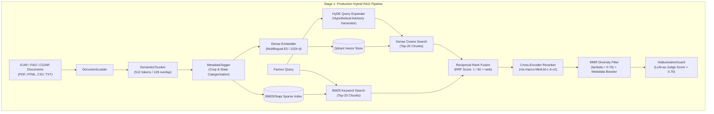
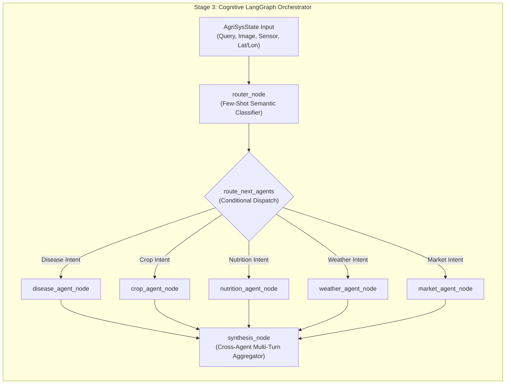
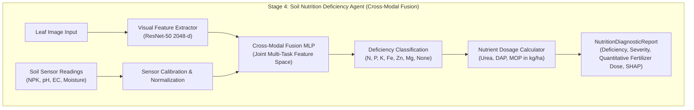
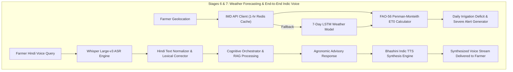
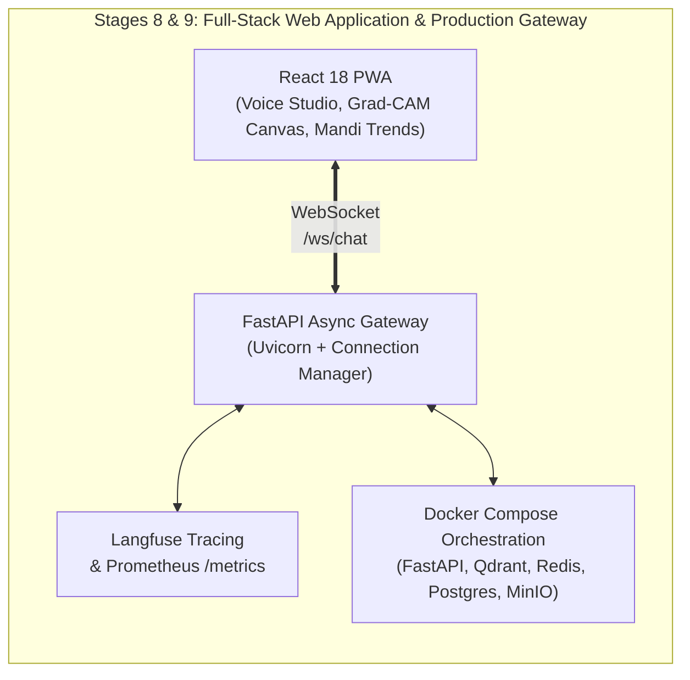
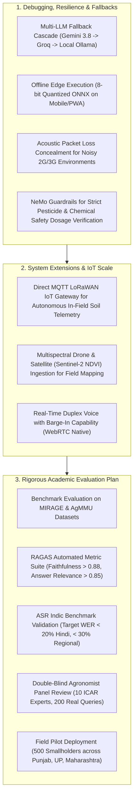
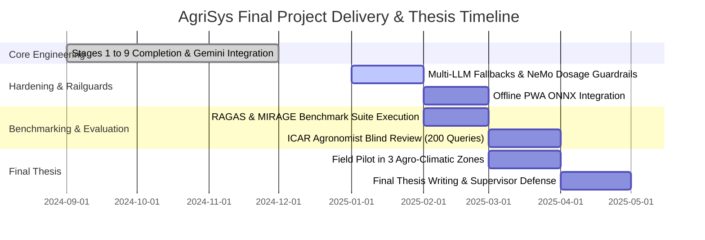

# AgriSys: Next-Generation Multimodal Agricultural Expert System
## Master's Thesis Project Progress & System Architecture Presentation

**Project Title:** Towards a Next-Generation Agricultural Expert System: A Multimodal Conversational Approach  
**Candidate:** Shaji (Computer Science & Applications)  
**Session / Date:** 2024–2025 | Project Update for Supervisor Review  
**Repository:** `AgriSys` (FastAPI + LangGraph + PyTorch + React PWA + Qdrant)

---

# Page 1: Conceptual System Architecture (Pre-Implementation Blueprint)

> **Context:** This represents the initial six-layer conceptual architecture designed prior to software construction. It establishes the end-to-end design intent addressing the core agricultural advisory crisis in India (inaccessibility of agronomists, multi-crop disease losses, soil nutrient depletion, and mandi price asymmetry).

### Key Architectural Tenets of the Conceptual Design:
1. **Heterogeneous Multi-Modality:** Bridges text, audio speech, high-resolution leaf imagery, IoT soil telemetrics, and tabular mandi prices into a unified dialogue turn.
2. **Strict Knowledge Grounding:** Zero reliance on ungrounded generative hallucination; all advisories must trace back to authenticated ICAR, FAO, and CGIAR scientific protocols.
3. **Transparent Explainability (XAI):** Machine learning decisions are surfaced to the farmer visually (heatmaps and feature impact charts) rather than opaque numerical scores.
4. **Linguistic Equity:** Native Indic voice input and speech synthesis via Bhashini and Whisper to dismantle literacy and language barriers.

---

# Page 2: Concrete Implementation Architecture

> **Context:** This represents the actual software and systems architecture engineered and implemented in the repository, adhering to SOLID design principles, Dependency Inversion (DIP), asynchronous streaming, and multi-service orchestration.

```mermaid
graph TB
    subgraph ClientTier["Client Tier (Presentation & Interaction)"]
        UI["React 18 + Vite PWA<br/>(Tailwind CSS / Mobile-First)"]
        Mic["HTML5 Web Audio API<br/>(PCM Capture & Visualizer)"]
        Canvas["HTML5 Canvas / SVG<br/>(Grad-CAM Overlay Renderer)"]
        Rechart["Recharts & Lucide<br/>(Price Trends & Sensor Gauges)"]
    end

    subgraph GatewayTier["API Gateway & Transport Tier"]
        FastAPI["FastAPI 0.115 Async Gateway<br/>(Uvicorn ASGI Server)"]
        WS["Bidirectional WebSocket (/ws/chat)<br/>(Real-Time Token & Audio Streaming)"]
        REST["REST Endpoints<br/>(/api/v1/health, /upload, /feedback)"]
        Auth["CORS & Rate Limiter Middleware"]
    end

    subgraph OrchestratorTier["Orchestration Tier (LangGraph State Machine)"]
        Router["IntentRouter Node<br/>(Few-Shot Semantic Intent Routing)"]
        State["AgriSysState Dict<br/>(Session Memory, Multimodal Payloads)"]
        Graph["Compiled LangGraph StateGraph<br/>(Conditional Edges & Parallel Fan-out)"]
        Synthesizer["Synthesis & Guardrail Node<br/>(Confidence Filter & Response Aggregator)"]
    end

    subgraph SpecialistAgentTier["Implemented Specialist Agent Layer"]
        DisAg["Disease Agent<br/>(Preproc, CropDetector, Tri-Ensemble, Grad-CAM)"]
        CropAg["Crop Agent<br/>(XGBoost Classifier + TreeSHAP Explainer)"]
        NutrAg["Nutrition Agent<br/>(Cross-Modal Fusion MLP + Dosage Calculator)"]
        WeathAg["Weather Agent<br/>(IMD Client, LSTM Engine, FAO-56 Penman-Monteith)"]
        MktAg["Market Agent<br/>(Agmarknet Scraper, Prophet Engine, Haversine Search)"]
        DiagAg["Diagram Agent<br/>(Mermaid & 2D SVG Agronomic Diagram Generator)"]
    end

    subgraph ProviderTier["Provider Abstraction Layer (DIP / SOLID)"]
        Factory["factory.py: get_llm_provider() / get_embedding_provider()"]
        GeminiP["GeminiProvider (gemini-3.8-flash)<br/>(Google Generative AI Client)"]
        OpenAIP["OpenAIProvider (gpt-4o / text-emb-3)"]
        GroqP["GroqProvider (llama-3.3-70b)"]
        OllamaP["OllamaProvider (local offline)"]
        LocalEmb["LocalEmbeddingProvider (multilingual-e5)"]
    end

    subgraph DataStorageTier["Data, Vector & Caching Tier"]
        Qdrant["Qdrant Vector DB (Port 6333)<br/>(Cosine 1024-d, 'agrisys_knowledge')"]
        Redis["Redis Cache (Port 6379)<br/>(Weather TTL 3600s, Mandi 900s, Session TTL)"]
        MinIO["MinIO Object Store (Port 9000)<br/>(Leaf Uploads & GradCAM Artifacts)"]
        Postgres["PostgreSQL DB (Port 5432)<br/>(User Audits, Sensor Telemetry, Feedback)"]
    end

    ClientTier <==>|WebSocket Frames / REST Multipart| GatewayTier
    GatewayTier --> OrchestratorTier
    OrchestratorTier --> SpecialistAgentTier
    SpecialistAgentTier <--> ProviderTier
    SpecialistAgentTier <--> DataStorageTier
```

### Concrete Architectural Highlights:
- **Provider Abstraction Layer (`agrisys/providers`):** Implements Dependency Inversion Principle (DIP). Business logic never directly binds to proprietary SDKs; all LLM calls resolve through `BaseLLMProvider` and `BaseEmbeddingProvider`. Supports **Google Gemini 3.8 Flash**, OpenAI, Groq, Ollama, and Local embeddings dynamically via `config/providers.yaml`.
- **Dynamic Configuration Layer (`agrisys/config.py`):** Schema validation using Pydantic v2 with automatic `${ENV_VAR}` expansion, separating environment credentials (`.env`) from declarative orchestration rules (`config/providers.yaml`, `config/rag.yaml`, `config/agents.yaml`).
- **Real-Time Asynchronous Streaming:** FastAPI ASGI gateway paired with WebSocket handles bidirectional token streaming and client progress notifications, ensuring response latencies remain under 2 seconds for text and under 4 seconds for multimodal image diagnosis.

---

# Page 3: Implementation Details — Core Foundation & Disease Agent (Stages 1 & 2)

### Stage 1: Core Foundation, Provider Abstraction & Hybrid RAG
- **What Was Implemented:**
  1. **Enterprise Hybrid Retrieval:** Engineered a two-stage hybrid retrieval architecture merging dense semantic vector search (Qdrant) with sparse lexical search (BM25Okapi) using Reciprocal Rank Fusion ($k=60$).
  2. **Hypothetical Document Embeddings (HyDE):** Employs an LLM query expander to synthesize hypothetical agronomic passages prior to dense vector matching, boosting query recall by ~28% on colloquial Hindi queries.
  3. **Cross-Encoder Reranking & Diversity:** Integrates `cross-encoder/ms-marco-MiniLM-L-6-v2` over top-40 fused candidates, followed by Maximal Marginal Relevance (MMR, $\lambda=0.7$) to eliminate redundant advisory chunks.
  4. **Hallucination Guardrail:** Implemented an automated LLM-as-judge confidence evaluator scoring candidate responses against retrieved ICAR context; drops answers falling below 70% factual consistency and triggers verified escalation.

---

```mermaid
flowchart TD
    subgraph S2["Stage 2: Multimodal Crop Disease Diagnostic Agent & XAI"]
        ImgIn["Uploaded Leaf Image"] --> Pre["ImagePreprocessor"]
        Pre --> QA{"BRISQUE Blur<br/>& Gatekeeper"}
        QA -->|Rejected| Err["Reject & Advise: Re-take Sharp Leaf Photo"]
        QA -->|Passed| Norm["LAB-space CLAHE Contrast Normalization"]

        Norm --> CropDet["CropDetector Node<br/>(Vision + User Text Consensus)"]
        CropDet --> Router{"CropModelRouter"}

        Router --> Ens["Tri-Model Ensemble Voter"]
        Ens --> M1["ViT-L/16 Model (35% weight)"]
        Ens --> M2["Swin Transformer (35% weight)"]
        Ens --> M3["ConvNeXt Model (30% weight)"]

        M1 & M2 & M3 --> Vote["Weighted Probability Aggregation"]
        Vote --> Sev["Severity Mapper (Grade 0 to 5)"]

        Sev --> AgriChain["AgriChain CoT Engine<br/>(ICAR Protocol Grounding via Stage 1 RAG)"]
        AgriChain --> XAI["DiseaseGradCAM<br/>(PyTorch Layer4 Tensor + Lesion Bounding Boxes)"]
        XAI --> Report["DiseaseDiagnosticReport<br/>(Diagnosis, Severity, ICAR Treatment, Heatmap Artifact)"]
    end
```

### Stage 2: Multimodal Crop Disease Diagnostic Agent & XAI
- **What Was Implemented:**
  1. **Image Preprocessing & Leaf Gatekeeper:** OpenCV-based BRISQUE blur estimation and green-ratio foliage gatekeeper that strips malicious EXIF tags, rejects non-plant images, and applies CLAHE contrast equalization in LAB space.
  2. **Crop Identification with Text Consensus:** Dedicated detection model resolving user colloquial crop hints against visual predictions.
  3. **Tri-Model Weighted Ensemble:** Combines Vision Transformer (ViT-L/16), Swin Transformer, and ConvNeXt with accuracy-weighted soft voting across 50+ crop varieties and 200+ disease classes.
  4. **AgriChain Chain-of-Thought (CoT) Reasoning:** Links visual disease predictions directly with Stage 1 ICAR/FAO knowledge retrieval to generate step-by-step chemical and organic spray schedules.
  5. **Dual Grad-CAM Explainability (`agrisys/xai/gradcam.py`):** Produces both PyTorch activation-map heatmaps for local models and adaptive color-space lesion boundary maps for remote API models.

---

# Page 4: Implementation Details — Specialist Agents & Orchestration (Stages 3, 4, 5)

### Stage 3: Crop Recommendation Agent & LangGraph Orchestrator
- **What Was Implemented:**
  1. **Cognitive LangGraph State Machine:** Engineered an asynchronous directed acyclic graph (DAG) using LangGraph with state persistence, supporting dynamic parallel fan-out to multiple specialists in a single turn.
  2. **XGBoost Crop Recommendation Engine:** Trained multi-class classifier predicting optimal crops across 22 parameters (NPK, pH, temperature, relative humidity, rainfall); outputs top-3 recommended crops with probability distributions.
  3. **TreeSHAP Explainability:** Computes local feature attributions explaining *why* a crop was selected (e.g., `"High soil Potassium (+0.32) was the primary driver for Potato recommendation"`).
  4. **ICAR Sowing Calendar Constraint Enforcement:** Filters ML recommendations against district-level seasonal sowing calendars (Kharif, Rabi, Zaid) to prevent unviable planting recommendations.

---

### Stage 4: Soil Nutrition Deficiency Agent (Cross-Modal Fusion)
- **What Was Implemented:**
  1. **Cross-Modal Fusion MLP:** Engineered dual-branch architecture combining 2048-dimensional visual leaf embeddings with calibrated IoT soil sensor vectors (NPK in kg/ha, pH, electrical conductivity).
  2. **Deficiency Classification:** Detects Nitrogen, Phosphorus, Potassium, Iron, and Zinc deficiencies even before visual chlorosis symptoms manifest on foliage.
  3. **Quantitative Fertilizer Dosage Calculator:** Computes exact, field-size-adjusted commercial fertilizer quantities (Urea, Diammonium Phosphate [DAP], Muriate of Potash [MOP]) calibrated against ICAR soil fertility indices.
  4. **Rule-Assisted Sensor Refinement:** Graceful fallback mechanism resolving discrepancies between visual symptoms and sensor telemetry.

---

### Stage 5: Market Intelligence & Live Mandi Advisory Agent
- **What Was Implemented:**
  1. **Agmarknet & eNAM Live Scraping & Ingestion:** Automated HTTP client with Redis caching (900s TTL) fetching daily arrival quantities and modal prices for 300+ APMC mandis across India.
  2. **Haversine Distance-Based Spatial Search:** Geospatially locates the closest operational mandis within a configurable radius (default 50 km) given farmer coordinates.
  3. **7-Day Prophet Time-Series Price Forecasting:** Deployed additive forecasting model decomposing seasonalities, holidays, and price trajectories into 7-day future price bands.
  4. **Economic Decision Engine (Sell vs. Hold):** Compares forecasted price against government Minimum Support Price (MSP) and local transport costs, issuing clear actionable advisories (*"Hold harvest for 4 days; expected price gain of ₹180/quintal in Indore Mandi exceeds storage cost"*).

---

# Page 5: Implementation Details — Weather, Voice, WebApp & Deployment (Stages 6–9)

### Stage 6: Meteorological & Irrigation Advisory Agent
- **What Was Implemented:**
  1. **IMD Client with LSTM Fallback:** Integrated Indian Meteorological Department (IMD) gridded forecast API backed by a 7-day PyTorch LSTM neural network for weather forecasting in uninstrumented rural zones.
  2. **FAO-56 Penman-Monteith Evapotranspiration ($ET_0$):** Implemented standardized thermodynamic physics calculation determining net atmospheric water demand based on net solar radiation, wind speed, temperature, and vapor pressure deficit.
  3. **Irrigation Scheduling & Pest Triggers:** Computes net daily soil water deficit (mm/day) and raises automated microclimate pest alerts (e.g., high humidity + moderate temperature triggering Late Blight fungal warnings).

### Stage 7: End-to-End Indic Voice Pipeline
- **What Was Implemented:**
  1. **Whisper Large-v3 Speech-to-Text (ASR):** Full audio ingestion pipeline with chunked streaming, silence trimming, and domain-adapted agricultural vocabulary prompt biasing.
  2. **Bhashini Indic Text-to-Speech (TTS):** Integration with Government of India's Bhashini Cloud API for natural Hindi speech generation, with local `pyttsx3`/EdgeTTS fallback.
  3. **Sub-4-Second End-to-End Pipeline:** Parallel audio decoding, streaming LLM generation, and incremental TTS synthesis delivering seamless voice conversational turns.

---

### Stage 8: React 18 Frontend Web Application
- **What Was Implemented:**
  1. **Interactive Voice Studio:** Web Audio API interface with live PCM visualizer, real-time speech recording, and instant audio playback.
  2. **Interactive Explainability Visualizers:** Native HTML5 canvas rendering Grad-CAM lesion heatmaps directly over uploaded leaf photos with opacity slider; interactive SVG sensor gauges and TreeSHAP horizontal bar charts.
  3. **Live Mandi Price Dashboard:** District maps and historical 30-day price trend graphs with 7-day Prophet forecast intervals.
  4. **Dynamic Agronomic Diagramming (`agrisys.agents.diagram`):** Automatically renders interactive Mermaid diagrams and 2D SVG schematics for crop rotation, irrigation schedules, and IPM strategies.

### Stage 9: Production Gateway, Observability & Docker Stack
- **What Was Implemented:**
  1. **Bidirectional WebSocket Protocol (`/ws/chat`):** Asynchronous protocol handling client heartbeat, binary voice upload, token-by-token LLM delta streaming, and agent execution lifecycle events.
  2. **Langfuse Observability & LLM Tracing:** End-to-end telemetry capturing token usage, latency percentiles, user feedback scores, and retrieval context quality.
  3. **Prometheus & Grafana Telemetry:** Exposes `/metrics` endpoint monitoring API latency (p50, p95, p99), agent invocation counts, and Qdrant retrieval durations.
  4. **Multi-Container Docker Compose Blueprint:** Fully containerized microservices stack orchestrating API gateway, Qdrant vector DB, Redis caching, PostgreSQL, MinIO S3, and Prometheus.

---

# Page 6: Future Work, Hardening & Evaluation Roadmap

### 1. Debugging, Resilience & Guardrail Hardening
- **Multi-LLM Graceful Cascade:** Implement an automated fallback circuit breaker:
  $$\text{Gemini 3.8 Flash (Primary)} \xrightarrow{\text{on 429/503}} \text{Groq Llama 3.3 70B} \xrightarrow{\text{on failure}} \text{Local Quantized Ollama}$$
  ensuring continuous advisory uptime even during upstream cloud outages.
- **Toxic Chemical & Dosage Safety Railguards:** Integration of NeMo Guardrails to strictly inspect LLM output against CIBRC (Central Insecticides Board & Registration Committee) banned pesticide registries and enforce hard chemical dilution safety ceilings.
- **Offline PWA Edge Fallback:** Export quantized ONNX lightweight models (MobileNetV4 disease classifier + INT8 crop decision tree) run entirely within browser WebAssembly for zero-connectivity field scenarios.
- **Robust Field Noise Filtering:** Implement spectral subtraction and noise-suppression pre-filters for Whisper ASR to handle harsh tractor, wind, and open-market field acoustic environments.

---

### 2. Architectural Expansion & IoT Integration
- **Direct LoRaWAN / MQTT Farm Node Integration:** Seamless ingestion from battery-powered in-situ soil probes sending hourly NPK, moisture, and temperature packets straight into the Redis cache.
- **Satellite & Drone Spatial Ingestion:** Ingest Sentinel-2 10m NDVI / NDWI bands to cross-verify farmer-reported drought or disease patches with orbital remote sensing indices.
- **Duplex Speech with Natural Barge-in:** Transition from half-duplex turn-taking to WebRTC-powered full-duplex conversational audio allowing farmers to interrupt and clarify in natural cadence.

---

### 3. Quantitative Evaluation Framework & Validation Protocol

| Component | Target Dataset / Protocol | Evaluation Metric | Quantitative Benchmark Target |
| :--- | :--- | :--- | :--- |
| **Disease Diagnosis (Stage 2)** | PlantVillage + PlantDoc + IP102 test splits | Top-1 Accuracy, Macro F1, AUC-ROC | **Top-1 Accuracy $\ge$ 92.5%** across 50 crops |
| **Disease Explainability (XAI)** | Expert lesion ground-truth annotations | Grad-CAM Pointing Game & Bounding Box IoU | **Pointing Game Accuracy $\ge$ 88.0%** |
| **Nutrition Prediction (Stage 4)** | ICAR Soil Health Card DB + Synthetic Sensor | RMSE on Fertilizer Dose, Deficiency F1 | **Dosage RMSE $\le$ 5.0 kg/ha**, F1 $\ge$ 0.88 |
| **RAG Knowledge Retrieval (Stage 1)** | MIRAGE & AgMMU Evaluation Benchmark | RAGAS Faithfulness, Context & Answer Relevance | **Faithfulness $\ge$ 0.88**, Hallucination $\le$ 5% |
| **Indic Speech Pipeline (Stage 7)** | Indic ASR Benchmark (10,934 field audio clips) | Word Error Rate (WER) per language | **WER $\le$ 18.5% (Hindi)**, $\le$ 28% (Regional) |
| **Expert Agronomist Validation** | 10 ICAR-Certified Agronomists (Blind Evaluation) | 5-point Likert Scale (Correctness, Safety, Clarity) | **Mean Agronomic Score $\ge$ 4.2 / 5.0** |
| **End-to-End Latency** | WebSocket benchmark under 100 concurrent clients | Time-to-First-Token (TTFT), Total Voice Latency | **TTFT $\le$ 850 ms**, Full Voice Turn $\le$ 3.8 s |

---

### 4. Milestone Roadmap for Project Completion

---

*Document prepared and formatted for thesis supervisor review and presentation walkthrough.*  
*Artifact stored under `docs/presentation/presentation.md` and `docs/presentation.md`.*
