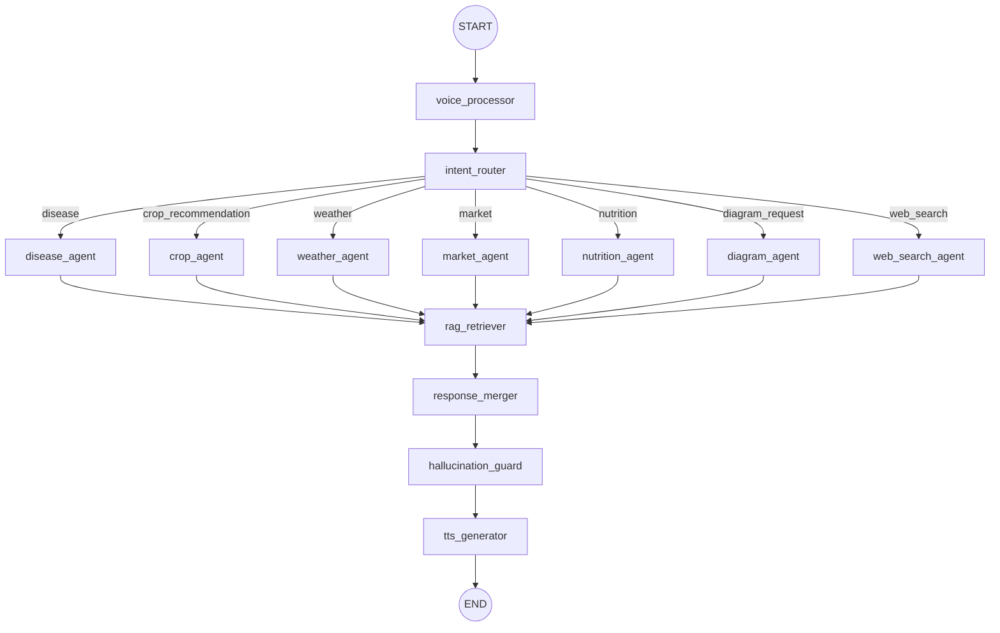

# Implementation Plan: Web Search Agent Integration

**Module**: `agrisys.agents.web_search`  
**Pipeline Integration**: LangGraph Multi-Agent Orchestrator (`agrisys.orchestrator.graph`)  
**Date**: September 2026  
**Status**: In Progress  

---

## 1. Context & Motivation

AgriSys previously comprised six specialized AI agents:
1. `disease_agent` — Vision-based crop disease diagnosis using ViT + Swin + ConvNeXt ensemble and Grad-CAM.
2. `crop_agent` — Soil- and climate-tailored crop recommendations via XGBoost.
3. `diagram_agent` — Dynamic Mermaid.js agronomic workflows, timelines, and layout diagrams.
4. `nutrition_agent` — Deficiency diagnosis and NPK fertilizer dosage planning.
5. `market_agent` — Real-time and 7-day forecasted mandi prices with e-NAM integration.
6. `weather_agent` — Open-Meteo forecasts and FAO-56 Penman-Monteith ET₀ irrigation advisories.

While the system has an internal Qdrant-backed RAG retriever for static agricultural manuals and ICAR packages of practices, it lacked the ability to query live external web resources. Farmers frequently inquire about:
- **Government Schemes & Subsidies** (e.g., latest PM-KISAN installment dates, PM Fasal Bima Yojana, state solar pump subsidies).
- **Breaking News & Outbreaks** (e.g., locust warnings, sudden pest incursions reported in neighboring districts).
- **Dynamic Agronomic Advisories & Policy Changes** (e.g., minimum support price announcements, export bans/tariffs, fertilizer availability notices).

To bridge this gap, a **Web Search Agent** is integrated into the multi-agent pipeline.

---

## 2. Architecture & Design Principles

### 2.1 Pluggable Multi-Provider Support
The agent is designed to be provider-agnostic, supporting:
- **DuckDuckGo**: Free, zero-configuration search without requiring API keys, ideal for offline/local development.
- **Tavily**: Specialized AI-research search engine delivering clean content snippets and markdown answers when `TAVILY_API_KEY` is present.
- **Direct HTTP Fallback**: Standardized `httpx` asynchronous client with resilient retries, timeout handling, and user-agent rotation.

### 2.2 Domain & Geolocation Filtering
Searches default to the Indian agricultural context (`region: "in-en"`), with ranking preference for trusted authoritative agricultural portals:
- `.gov.in` (e.g., `pmkisan.gov.in`, `agricoop.nic.in`, `farmer.gov.in`)
- `icar.org.in` (Indian Council of Agricultural Research)
- State Agricultural Universities (SAUs)
- Reputable agricultural news publications

### 2.3 LangGraph State Integration
The agent functions as a first-class citizen in the LangGraph StateGraph:
- **Input**: User query, detected intent, optional crop context, and location metadata.
- **Processing**: Query reformulation, search execution, snippet ranking, and source URL collection.
- **Output**: Writes into `state["agent_results"]`, `state["citations"]`, and `state["rag_chunks"]` using `operator.add` so downstream nodes (`rag_retriever`, `response_merger`, `hallucination_guard`) seamlessly synthesize and cite live web findings.

---

## 3. Workflow Diagram

---

## 4. Components & File Modifications

### 4.1 New Agent Package: `agrisys/agents/web_search/`
- **`models.py`**: Pydantic v2 data structures (`SearchResultItem`, `WebSearchQuery`, `WebSearchReport`).
- **`client.py`**: Asynchronous `WebSearchClient` supporting DuckDuckGo and Tavily with fallback mechanisms.
- **`agent.py`**: `WebSearchAgent` logic coordinating query formulation, execution, and synthesis.
- **`node.py`**: `web_search_agent_node` LangGraph async state node.
- **`__init__.py`**: Public export interface.

### 4.2 Configuration
- **`config/providers.yaml`**: Add `web_search` section specifying provider, max results, and timeout.
- **`config/agents.yaml`**: Add agent-specific configuration (region, safe search, domain boosts).
- **`agrisys/config.py`**: Add `WebSearchConfig` Pydantic model into `ProvidersConfig`.
- **`.env.example` & `.env`**: Add `TAVILY_API_KEY` placeholder.

### 4.3 Orchestration & Routing
- **`agrisys/orchestrator/intent_router.py`**:
  - Add `web_search` keywords (`scheme`, `subsidy`, `pm kisan`, `yojana`, `news`, `policy`, `update`, `guidelines`, `portal`, `current affairs`).
  - Extend LLM intent classifier prompt with `web_search`.
- **`agrisys/orchestrator/graph.py`**:
  - Register `web_search_agent` node.
  - Wire conditional routing edges from `intent_router`.
  - Wire edge from `web_search_agent` to `rag_retriever`.

### 4.4 Tests & Verification
- **`tests/test_web_search_agent.py`**:
  - Test client search and fallback handling.
  - Test state node execution and data aggregation.
  - Test intent router classification for web search triggers.
  - Test full graph compilation and execution.
